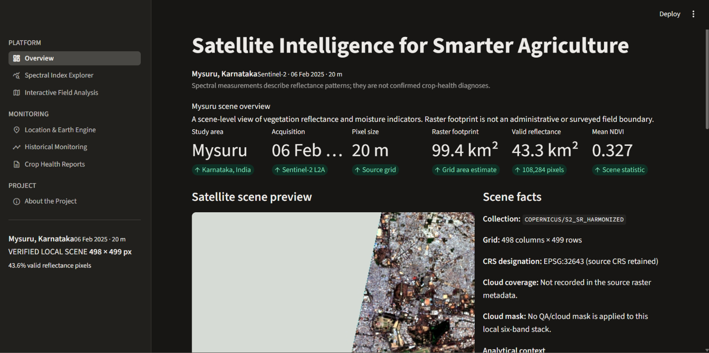
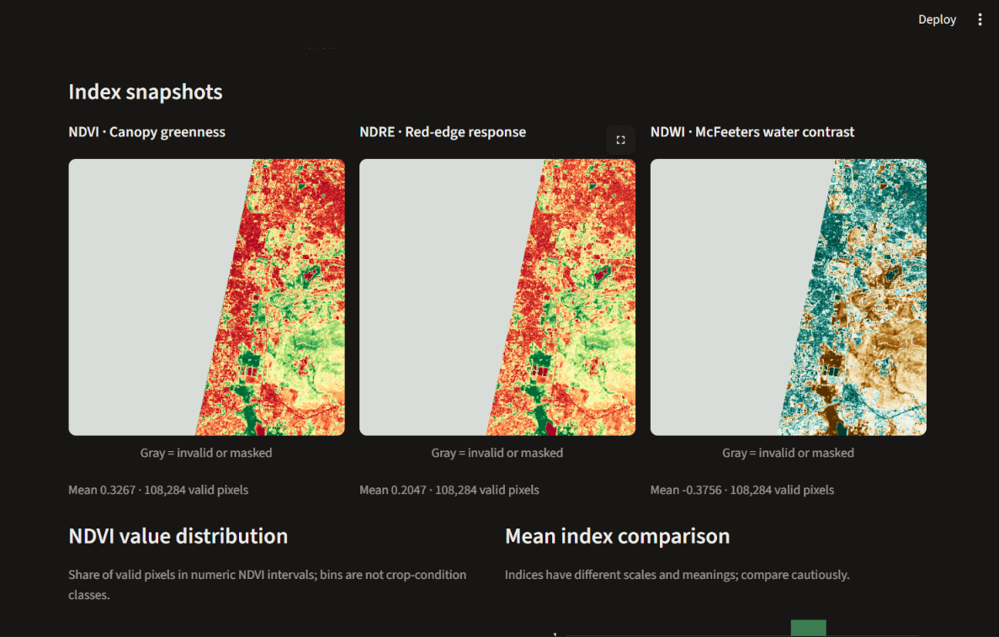
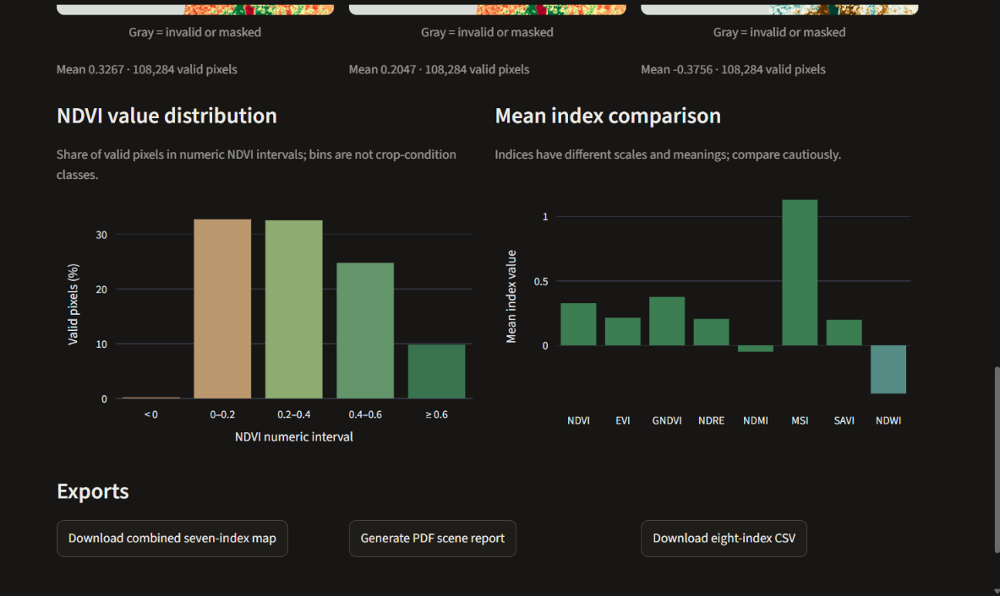
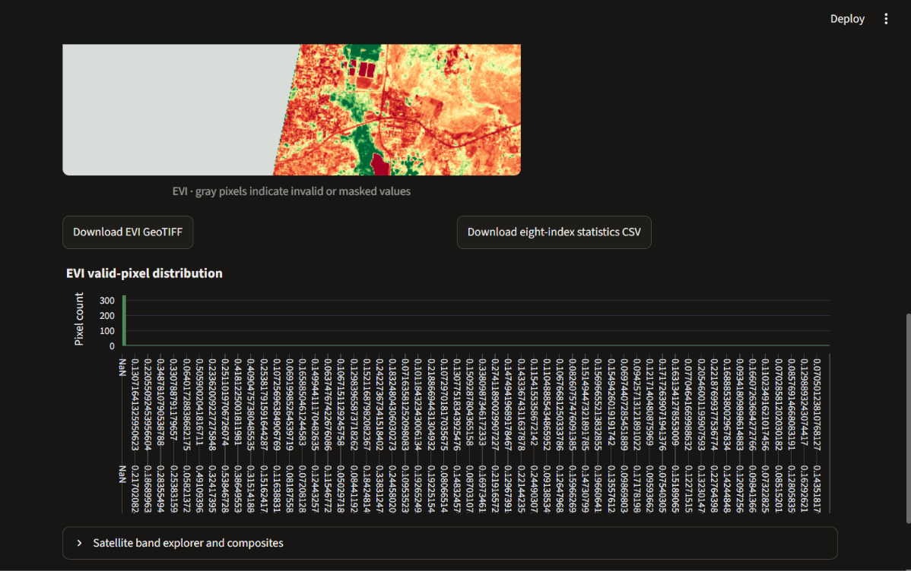
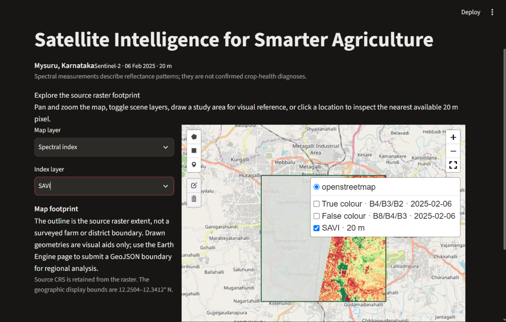
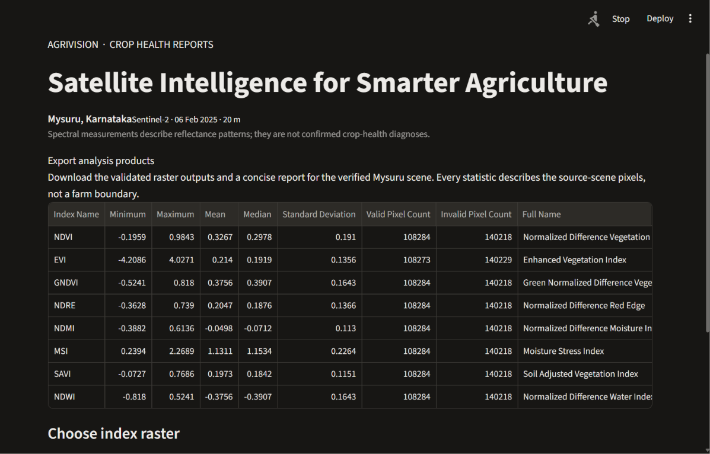

# AgriVision — Satellite Crop Health Monitoring

AgriVision is a satellite-based crop-monitoring project with a reproducible Sentinel-2 analysis notebook, a local Flask dashboard, and a multi-page Streamlit application.

The verified local scene is:

- **Notebook:** `notebooks/sentinel2_all_7_indices.ipynb`
- **Input:** `data/sentinel2_complete_bands/Mysuru_Sentinel2_6_Bands.tif`
- **Study area:** Mysuru, Karnataka, India
- **Acquisition date:** 6 February 2025
- **Collection:** `COPERNICUS/S2_SR_HARMONIZED`
- **Grid:** 498 × 499 pixels at 20 m
- **CRS:** inherited from the source raster (EPSG:32643 designation)
- **Source bands:** B2, B3, B4, B5, B8, and B11

## Run the seven-index workflow

Open the notebook in VS Code using the workspace `.venv` Python interpreter and run all cells. The project root is located from either the workspace root or `notebooks` directory. Edit the configuration in Section 3 to use another compatible scene.

The configured input must be a co-registered six-band GeoTIFF with descriptions in this order: B2 (Blue), B3 (Green), B4 (Red), B5 (Red Edge 1), B8 (Near Infrared), and B11 (Shortwave Infrared 1). The workflow expects 20 m pixels and scaled surface reflectance (stored values divided by 10,000). It validates these requirements; it does not fetch or resample imagery.

## Outputs

Products are written to `outputs/all_7_indices/`:

- `sentinel2_all_7_indices.png` — 2 x 4 index map with individual color bars.
- `index_statistics.csv` — per-index descriptive statistics and valid/invalid pixel counts.
- `project_summary.txt` — scene, band, index, and output metadata.
- `geotiff/` — individual Float32 NDVI, EVI, GNDVI, NDRE, NDMI, MSI, and SAVI maps.

The source mask and the positive, finite six-band reflectance mask are retained. EVI additionally masks denominator magnitudes below 0.1. Exported rasters use `-9999` as NoData and inherit the source CRS and geotransform without CRS reconstruction.

## What the web app includes

The Streamlit app reuses the verified local raster products and provides:

| Page | Features |
|---|---|
| **Overview** | Scene metadata and metrics, true-colour preview, index snapshots, NDVI distribution, and summary exports. |
| **Spectral Index Explorer** | NDVI, EVI, GNDVI, NDRE, NDMI, MSI, SAVI, plus McFeeters NDWI; formulas, statistics, histograms, composites, and GeoTIFF/CSV downloads. |
| **Interactive Field Analysis** | Toggle raster and index layers, draw visual reference shapes, and click a location to inspect the nearest source pixel. |
| **Location & Earth Engine** | Upload a study-area GeoJSON and request Sentinel-2 imagery and regional statistics from Earth Engine. |
| **Historical Monitoring** | Plot per-scene NDVI, NDRE, and NDWI statistics and compare earliest/latest maps for real Earth Engine observations. |
| **Crop Health Reports** | Download GeoTIFFs, statistics, project summary, PDF report, and a ZIP bundle. |
| **About the Project** | Review the bands, formulas, masking policy, processing details, and limitations. |

### App screenshots

#### Overview — scene and satellite preview



#### Overview — index snapshots and analytics





#### Spectral index explorer



#### Interactive field analysis



#### Crop health reports



## Run the web dashboard

Install the project dependencies if needed, then start the local Flask app from the project root:

```powershell
.\.venv\Scripts\python.exe -m pip install -r requirements.txt
.\.venv\Scripts\python.exe web_app\app.py
```

Open [http://127.0.0.1:5000](http://127.0.0.1:5000). The dashboard reads the verified Mysuru scene products above. It includes a selectable map for each index, click-to-inspect pixel values and map coordinates, per-index statistics, scene and band metadata, the combined seven-map visualization, and downloads for the GeoTIFFs, CSV, overview image, and project summary. The server binds to localhost and does not upload data or contact external map services.

## Run the AgriVision Streamlit app

From the project root, install the dependencies and start Streamlit:

```powershell
.\.venv\Scripts\python.exe -m pip install -r requirements.txt
.\.venv\Scripts\streamlit.exe run app\app.py
```

Open the local URL printed by Streamlit, typically [http://localhost:8501](http://localhost:8501). The app can also be opened at [http://127.0.0.1:8501](http://127.0.0.1:8501) while the Streamlit server is running.

## Optional Google Earth Engine features

The local dataset contains only the verified Mysuru scene from 6 February 2025. Other locations and dates are not bundled. To request other real Sentinel-2 scenes, Earth Engine requires network access, user authentication, and a Google Cloud project enabled for Earth Engine. In PowerShell:

```powershell
.\.venv\Scripts\earthengine.exe authenticate
$env:EARTHENGINE_PROJECT = "your-earth-engine-enabled-project"
.\.venv\Scripts\streamlit.exe run app\app.py
```

The app does not initiate authentication or claim imagery is available before an Earth Engine query succeeds. Earth Engine cloud filtering uses scene-level `CLOUDY_PIXEL_PERCENTAGE`, not AOI-specific cloud coverage. The historical workflow uses real matching observations; it does not infer a date for the undated `data/Mysuru_NDVI_2024.tif`.

## Method and interpretation notes

- Reflectance digital numbers are divided by 10,000 before index calculations.
- A local pixel is valid only when all six source-band values are finite and positive; EVI additionally masks denominator magnitudes below 0.1.
- Index values are not clipped. Invalid pixels are shown in gray and exported as NoData.
- The app's additional **NDWI** is the McFeeters Green–NIR formula `(B3 - B8) / (B3 + B8)`; it is distinct from NDMI `(B8 - B11) / (B8 + B11)`.
- The map outline is the source raster footprint, not a surveyed field or administrative boundary. Drawn shapes are visual aids and do not produce local zonal statistics.
- Vegetation and moisture indices are spectral indicators, not verified crop-health diagnoses or substitutes for field observations and agronomic expertise.
- Local mode reads existing products. Earth Engine queries and basemap/font loading may contact external services; OpenStreetMap tiles are used in interactive maps.

## Tests

Run the focused project tests with:

```powershell
.\.venv\Scripts\python.exe -m unittest discover -s tests -v
```