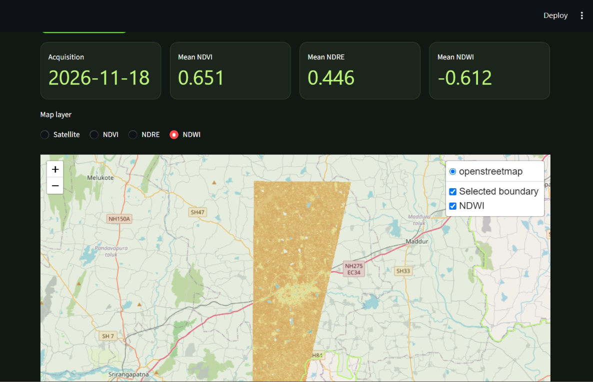
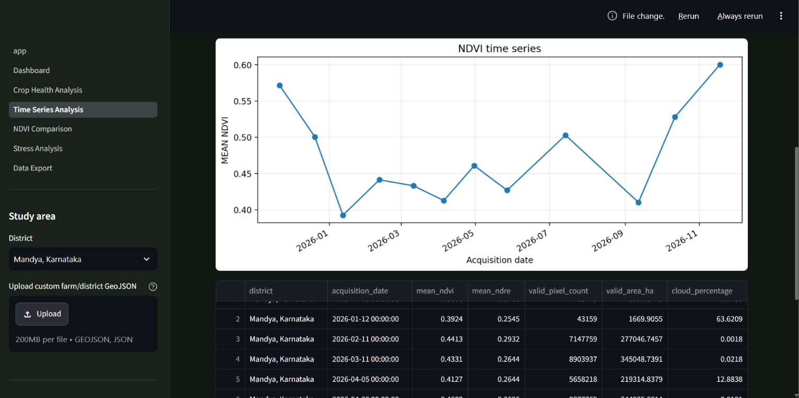
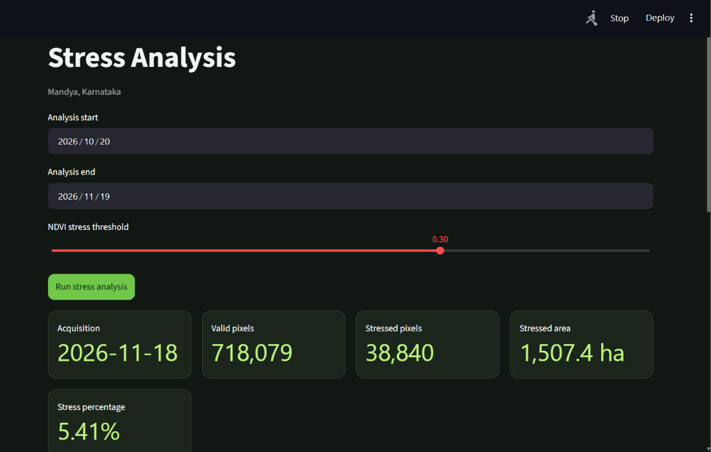
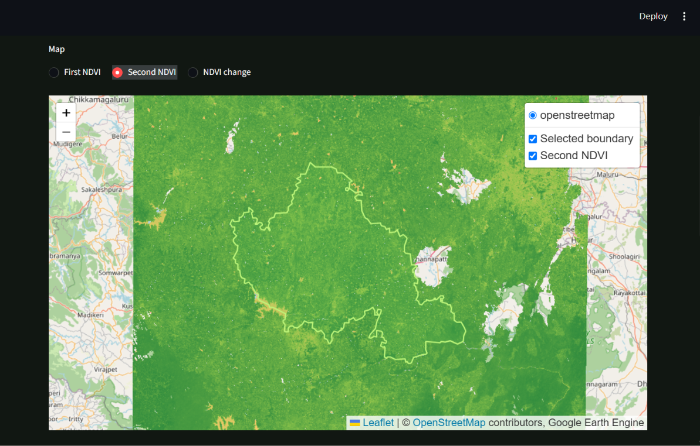
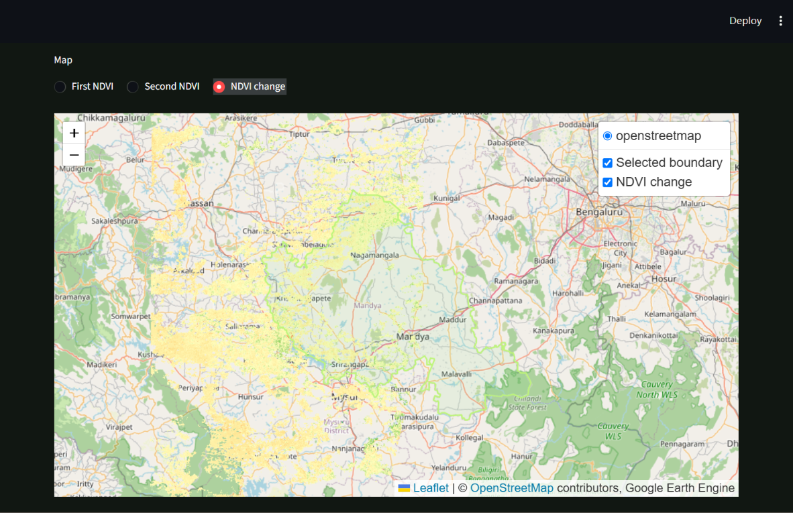
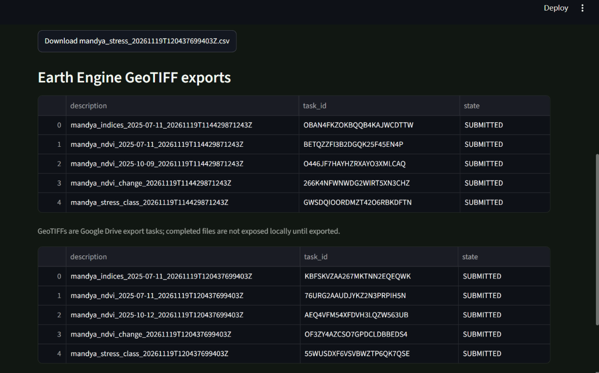

# Satellite-Based Crop Health Monitoring

This project uses Sentinel-2 Surface Reflectance Harmonized imagery and Google
Earth Engine (GEE) to monitor vegetation conditions in Mandya, Mysuru, and
Hassan districts, Karnataka. Each district has an independently validated
boundary, report area, time-series area, and Drive export folder.

Vegetation indices describe observed vegetation conditions; they do not
independently diagnose crop diseases, identify crop species, or replace field
inspection.

## Features

- **Districts and boundaries:** validated Mandya, Mysuru, and Hassan district
  GeoJSON boundaries, plus Polygon/MultiPolygon farm GeoJSON uploads.
- **Sentinel-2 processing:** filter Sentinel-2 SR Harmonized imagery by date,
  region, and cloud percentage; select suitable imagery using valid-pixel
  coverage; apply a shared SCL cloud, shadow, and snow mask.
- **Vegetation indices:** calculate and map NDVI, NDRE, and green-NIR NDWI with
  regional statistics.
- **Date comparison:** compare user-selected dates and calculate NDVI change
  only for pixels valid on both dates.
- **Time series:** generate 12- or 24-observation NDVI/NDRE series over a
  selected date range, with CSV data and charts. Web reductions are batched
  and identical requests are cached for one hour.
- **Crop stress:** apply a configurable NDVI threshold, report stressed area
  and percentage, and preserve invalid pixels as NoData.
- **Exports:** download analysis tables as CSV and submit GeoTIFFs as
  asynchronous Earth Engine Google Drive tasks with task-status feedback.
- **CLI pipeline:** run one district or all three districts independently,
  writing timestamped reports, charts, time-series data, and export manifests.

## Technology

Python, Google Earth Engine, Sentinel-2 SR Harmonized, NumPy, Pandas, Rasterio,
Matplotlib, Shapely, GeoJSON, and GeoTIFF.

## Project layout

```text
data/
  boundaries/                 # geoBoundaries district polygons (WGS 84)
  sample_boundary.geojson     # original sample input, retained unchanged
app/
  app.py                      # Streamlit application entry point
  pages/                      # dashboard and analysis/export pages
  components/                 # shared maps, controls, charts and styles
src/
  boundary_manager.py         # uploaded/bundled boundary handling
  analysis_engine.py          # web index analysis
  timeseries_engine.py        # web time series
  comparison_engine.py        # date comparison
  stress_engine.py            # stress classes and area statistics
  export_manager.py           # CSV/JSON and Drive GeoTIFF tasks
gee/
  boundaries.py               # CLI boundary validation and EE conversion
  config.py                   # project, date, and output configuration
  ndvi_date_comparison.py     # CLI date comparisons
  ndvi_ndre_timeseries.py     # CLI time series
  ndvi_stress_analysis.py     # local raster stress processing
  raster_utils.py             # local raster operations
  sentinel2_fetcher.py        # Sentinel-2 selection and mosaics
  sentinel2_processor.py      # shared masks and index calculations
main.py                       # district and all-district CLI
tests/                        # local unit tests and optional live smoke test
docs/
  architecture.md
  screenshots/                # example web application screenshots
outputs/<district>/
  maps/                       # Earth Engine Drive export task manifests
  charts/
  reports/
  timeseries/
```

Earth Engine GeoTIFFs are submitted as Google Drive export tasks, not silently
downloaded to the local machine. The CSV manifest in each district's `maps/`
directory records task IDs and task states; check Earth Engine Tasks and
download completed pipeline exports from the configured Drive folder. The web
app submits GeoTIFF exports on demand to the `crop_health_monitoring` folder
and displays each task's status; completed web-app exports can be downloaded
from that Google Drive folder. Local reports,
time-series CSVs, and charts are written beneath the corresponding district.
The app's GeoTIFF controls submit tasks only when requested; importing or
viewing a page does not launch an export.

## Install on Windows

Open PowerShell in the project directory. If this workspace has no virtual
environment yet, create one:

```powershell
py -m venv .venv
.\.venv\Scripts\Activate.ps1
python -m pip install --upgrade pip
python -m pip install -r requirements.txt
```

If PowerShell blocks activation, use the venv interpreter directly:

```powershell
.\.venv\Scripts\python.exe -m pip install -r requirements.txt
```

Select `.venv\Scripts\python.exe` in VS Code with **Python: Select Interpreter**.

## Earth Engine authentication

The CLI reuses the active Earth Engine credentials and initializes the
configured project (`agri-satellite-monitoring`) only when the pipeline runs.
Authenticate interactively once if required:

```powershell
earthengine authenticate
```

The Google account must have access to the project and permission to create
Earth Engine exports. Authentication tokens are managed by the Earth Engine
client and are not stored in this repository. An initialization or access
failure is logged and the pipeline exits with a non-zero status.

## District boundary provenance

The three district GeoJSON files are actual administrative polygons from
[geoBoundaries](https://www.geoboundaries.org/), India ADM2, boundary vintage
2021, downloaded from the
[pinned geoBoundaries release](https://github.com/wmgeolab/geoBoundaries/tree/9469f09/releaseData/gbOpen/IND/ADM2).
The source labels
Mysuru as **Mysore**; the file retains that source name and records the
canonical project district as Mysuru. The source's API metadata declares the
Open Data Commons Open Database License (ODbL) 1.0; attribution is required.
See geoBoundaries' [data-use information](https://www.geoboundaries.org/).
Coordinates are longitude/latitude (EPSG:4326); geometry validity is checked
with Shapely before use. The original `data/sample_boundary.geojson` remains
untouched and is not substituted for the district boundaries.

## Run the pipeline

```powershell
python main.py --district mandya
python main.py --district mysuru
python main.py --district hassan
python main.py --all
```

Customize the time-series period:

```powershell
python main.py --district mandya --start-date 2025-01-01 --end-date 2026-01-01
```

Each date target searches a seven-day interval on either side, mosaics tiles
from each acquisition date, and selects the date with the most valid
SCL-masked B8 pixels in the district. Time-series observations are mosaicked
by acquisition date and limited to 24 dates per district in the CLI. The web
time-series page samples 12 or 24 observations across the selected range,
batches Earth Engine reductions, and caches identical results for one hour.
Exports are asynchronous Google Drive tasks. A district failure is logged and,
with `--all`, does not prevent the other districts from running.

## Indices and masking

- **NDVI** = (B8 − B4) / (B8 + B4), near-infrared and red.
- **NDRE** = (B8 − B5) / (B8 + B5), near-infrared and red edge.
- **NDWI** = (B3 − B8) / (B3 + B8), green and near-infrared.

All three use the same Sentinel-2 Scene Classification Layer (SCL) mask.
Classes **2** (dark-area pixels), **4** (vegetation), **5** (bare soil), and
**6** (water) are retained. Classes **0** (no data), **1** (saturated or
defective), **3** (cloud shadow), **7** (unclassified/low-probability cloud),
**8–10** (clouds/cirrus), and **11** (snow or ice) are excluded. Indices remain
masked where source observations are invalid; masked pixels are never treated
as zero.

Date-change rasters are computed as second-date minus first-date NDVI on the
intersection of both valid masks. Reports record the separate and common valid
pixel counts, common valid area, and its percentage of district area.

## Stress classification

NDVI values below **0.30** are classified as stressed (`1`); valid values at or
above the threshold are non-stressed (`0`); invalid observations are NoData
(`255`). Cloud-masked pixels are never counted as stressed. The Earth Engine
workflow reports valid/stressed pixel counts and area using `pixelArea()`.
Exact total-grid and NoData cell counts require inspecting the exported raster;
the local Rasterio function reports these counts and uses the raster CRS,
transform, and pixel dimensions for area calculations.

## Local raster processing and tests

The local stress utility validates a single-band projected NDVI GeoTIFF,
retains its CRS, transform, and dimensions, writes a separate `uint8` output,
and reopens it to validate the result. It rejects geographic-CRS area
calculations rather than treating angular degrees as metres.

Run local tests:

```powershell
python -m unittest discover -s tests -v
```

These are local unit tests for bundled boundaries, geometry checks, valid-mask
date differences, stress classification, area calculation, and GeoTIFF
metadata. They do not authenticate to Earth Engine. A live integration run
must be performed separately with valid GEE credentials and permissions; do
not interpret local tests or queued exports as proof of completed satellite
processing.

Run the optional live GEE web-backend smoke test:

```powershell
python tests/live_gee_smoke.py
```

This test calls Earth Engine for Mandya, Mysuru, and Hassan and prints actual
acquisition dates and index means. It requires credentials and project access.

## Known limitations

- Earth Engine export tasks require network access, project access, and Drive
  export permissions. Exports are queued asynchronously and are not copied
  automatically to the local `outputs/` tree.
- A district-wide target-date result mosaics a single acquisition date from a
  short date window; seasonal clouds and observation timing can still
  constrain comparisons.
- The local area tool requires a projected CRS whose linear unit can be
  converted to metres.
- Live Earth Engine processing still requires credentials and project
  permissions. Project imports use Rasterio's bundled PROJ database for this
  Python process only; PostgreSQL and system configuration are not modified.

## Launch the web application

Install the web dependencies:

```powershell
python -m pip install -r requirements.txt
streamlit run app/app.py
```

Open the local URL printed by Streamlit. Use the sidebar to select Mandya,
Mysuru, Hassan, or upload one Polygon/MultiPolygon GeoJSON. Analysis results
remain empty until Earth Engine processing is run.

The app uses the same Earth Engine project and account permissions as the CLI.
Complete Earth Engine authentication before running an analysis or submitting
an export. Do not put credentials or token files in the repository.

### Web pages

- **Dashboard:** selected district/farm boundary, area, and summary metrics.
- **Crop Health Analysis:** date-range and cloud-filtered Sentinel-2 imagery,
  true-color, NDVI, NDRE, and NDWI maps and GeoTIFF export.
- **Time Series Analysis:** select a date range and 12 or 24 observations;
  inspect NDVI/NDRE charts and table data, and download CSV.
- **NDVI Comparison:** choose two dates, inspect each NDVI layer and the
  common-valid-pixel change map, and export the change GeoTIFF.
- **Stress Analysis:** choose dates and an NDVI threshold; view valid/stressed
  pixel counts, stressed area/percentage, map, CSV, and GeoTIFF.
- **Data Export:** access local CSV outputs and view Earth Engine export tasks.

## Application screenshots

These screenshots show example results from the Streamlit application:

### Crop health indices



### NDVI time series



### Stress analysis



### NDVI comparison





### Earth Engine exports


